# Estúdiate

> A study app where AI works on your notes: it summarizes them, quizzes you, reads photos of handwritten pages and transcribes recorded classes.

**Status:** Live · https://estudiate.vercel.app
**Models:** Llama 3.3 70B · Llama 4 Scout (vision) · Whisper large v3 turbo (audio) · GPT-OSS 120B · Kimi K2, all served through Groq

  
  

## What it is

A study app built around active learning: capture, consolidate, and recall. It has a block editor, flashcards from highlights, spaced repetition, and an assistant that works on the page you have open.

## Why it exists

Studying means taking notes, reviewing them, and remembering. Note apps solve the first part and barely touch the rest.

## How it works

Text, files, photos and audio can all go in. Photos and audio are turned into text, and whatever you highlight becomes a flashcard.

1. **Capture:** text, file, photo or audio.
2. **Vision and audio:** Llama 4 Scout and Whisper turn it into text.
3. **Assistant:** works on the content of the open page.
4. **Flashcards:** whatever you highlight becomes a card.
5. **Review:** FSRS decides when each card comes back.

## How the AI is used

**The model does:**
- Working on the open page, it summarizes, generates questions, explains or builds a concept map.
- Llama 4 Scout extracts the text from a photo, including handwriting.
- Whisper large v3 turbo transcribes a recorded class.

**The code controls:**
- With an account, AI calls go through a proxy on Vercel Edge that validates the session and keeps the key on the server.
- Each response is capped at 2,000 tokens to protect the shared quota.
- Without a key, the AI answers in demo mode and says so.
- FSRS, a spaced-repetition algorithm, decides when each card is shown again.

**A person decides:**
- Each person chooses what to highlight and turn into a card.
- Each person also picks the model, depending on whether they want speed or more reasoning.

## Design decisions

- **Two ways to use the AI.** With an account, everything goes through the proxy and the key never reaches the browser. Without an account, each person uses their own key.
- **Model of your choice.** Llama 3.3 70B by default. Llama 3.1 8B for speed; GPT-OSS 120B or Kimi K2 for more reasoning.
- **It never looks empty.** Without a key, the AI answers in demo mode and says so, so the app can be tried right away.

## Stack

React · TypeScript · Vite · Zustand · Tailwind CSS · Groq · Supabase Auth · Vercel Edge

## Numbers

- 4 chat models to choose from
- 3 ways to load content: text, photo and audio
- 2,000 maximum tokens per response

---

The source code is private. This repository explains how the project works, not its code.
Portfolio: https://ignaciomoralesdev.vercel.app
